Soy <b>Francisco Alberto Fernández Alcántara</b>, desarrollador de software .NET / C#. 
Técnico Superior en Desarrollo de Aplicaciones Multiplataforma (2024 – 2026). 
Backend con ASP.NET Core y APIs REST, y aplicaciones multiplataforma con .NET MAUI. 
Hablo español (nativo) e inglés (A2).

## Stack

## Proyecto destacado: FrivGame

App de minijuegos para Android y escritorio, con modo online y offline, cuentas de usuario, niveles, logros y ranking en tiempo real. Fue mi proyecto final de grado y lo diseñé de principio a fin: cliente, API y base de datos funcionando en producción.

## Ahora mismo

## Portfolio

Lo construí como un editor de código, con explorador de archivos, pestañas y una terminal que funciona. Está hecho con Blazor y desplegado en GitHub Pages y Azure Static Web Apps. Prueba a escribir `sudo hire me`.

**[franciscoalberto06.github.io](https://franciscoalberto06.github.io)**

## Contacto

- LinkedIn: [francisco-alberto-fernandez-alcantara](https://www.linkedin.com/in/francisco-alberto-fernandez-alcantara)
- Portfolio: [franciscoalberto06.github.io](https://franciscoalberto06.github.io)
- Email: [francisfdez591@gmail.com](mailto:francisfdez591@gmail.com)
